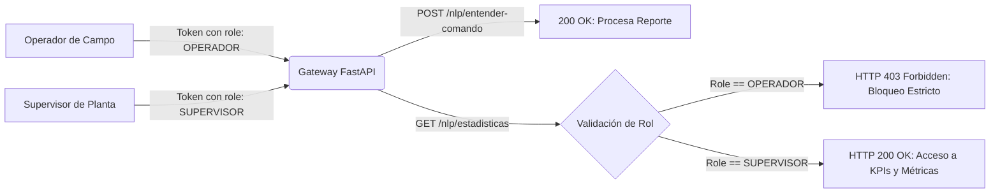

# Análisis Técnico Comparativo, Seguridad RBAC y Almacenamiento Efímero
**Mini-Azure LUIS v2 — Seminario de Especialización Cloud & IA (2026)**

---

## 1. Diferencias de Arquitectura: Nube Pública (Render) vs Red Local (LAN)

La transición de una arquitectura local sobre red de área local (**LAN**) hacia una plataforma como servicio (**PaaS**) pública en la nube introduce cambios radicales en accesibilidad, seguridad y gestión de infraestructura:

| Dimensión Técnica | Versión v1 (Despliegue Local LAN) | Versión v2 (Nube Pública Render Free) |
| :--- | :--- | :--- |
| **Topología y Alcance** | Limitado a la subred privada física/Wi-Fi (ej. `192.168.1.XX` o `192.168.137.XX`). Requiere estar físicamente en la misma red. | Accesible globalmente mediante URL pública HTTPS (`https://mini-azure-luis-v2-kbos.onrender.com`) desde cualquier dispositivo móvil o PC con conexión a internet. |
| **Exposición de Puertos** | Dos puertos TCP abiertos simultáneamente en la máquina host (Backend `8001`, Frontend `8501`) con reglas de Firewall locales. | **Un solo puerto público dinámico (`$PORT`)** expuesto hacia el exterior, orquestado mediante un proxy inverso ligero (Nginx) que enruta internamente hacia FastAPI (`8001`) y Streamlit (`8501`). |
| **Cifrado en Tránsito** | Comunicación en texto claro sin cifrar (`HTTP plano`), vulnerable a intercepción (*sniffing*) y ataques *Man-in-the-Middle* (MitM) en la red LAN. | Cifrado criptográfico en tránsito con **TLS/SSL (HTTPS)** con terminación automática de certificados gestionada por la nube. |
| **Políticas de Origen (CORS)** | Riesgo de bloqueo por CORS cruzado al comunicarse el cliente web con una IP privada distinta. | Cero problemas de CORS: Streamlit y FastAPI residen en el mismo contenedor monolítico y se comunican a través de `127.0.0.1:8001` con latencia despreciable. |
| **Ciclo de Vida** | El servidor permanece activo mientras la PC esté encendida. Sin reinicios automáticos por inactividad. | Ciclo de vida efímero con suspensión por inactividad (*sleep* tras 15 minutos) y reactivación automática por petición (*cold start*). |

---

## 2. Riesgos de Seguridad Mitigados con Autenticación JWT y RBAC

En la versión v1 LAN, los endpoints eran de libre consumo; cualquier dispositivo conectado a la red Wi-Fi del packing podía consultar estadísticas o reiniciar el historial de la planta. La versión v2 mitiga integralmente estos riesgos mediante un esquema estricto de **Role-Based Access Control (RBAC)** firmado con tokens **JWT (JSON Web Tokens)**:

1. **Prevención de Escalada de Privilegios:** La dependencia `require_role(["SUPERVISOR"])` valida criptográficamente el rol contenido en el payload del JWT antes de invocar los métodos de analítica (`/nlp/estadisticas` y `/nlp/estadisticas/reiniciar`). Los intentos de operarios de campo son interceptados de inmediato devolviendo **`HTTP 403 Forbidden`**.
2. **Autenticación Fuerte sin Estado (*Stateless*):** Cada petición debe incluir el encabezado `Authorization: Bearer <token>`. La firma simétrica basada en `HS256` y la clave criptográfica `JWT_SECRET_KEY` impiden la falsificación o alteración del payload. Si el token expira (`exp: 120 min`) o es manipulado, el backend responde **`HTTP 401 Unauthorized`**.
3. **Aislamiento de Secretos de Producción:** Las credenciales de usuarios (`OPERADOR_*` y `SUPERVISOR_*`) y la clave secreta nunca residen en el código fuente ni en el historial de Git, sino que se inyectan en tiempo de ejecución a través de las variables de entorno de Render.

---

## 3. Impacto del Entorno Gratuito en la Persistencia de Estadísticas

Las plataformas Cloud PaaS gratuitas (como Render, Koyeb y Railway) operan sobre **sistemas de archivos efímeros (*ephemeral filesystems*)**:

### A. Comportamiento en Nivel Gratuito
- **Suspensión por Inactividad (*Spin-down*):** Cuando la aplicación no recibe tráfico durante 15 minutos, el contenedor entra en estado de reposo.
- **Pérdida de Estado en Cold Start:** Al ingresar una nueva solicitud entrante, Render aprovisiona un nuevo contenedor a partir de la imagen Docker inmutable. Cualquier archivo escrito localmente en tiempo de ejecución (como `historial.json`) **se destruye**.

### B. Mecanismos de Resiliencia Implementados (`analytics.py`)
Para cumplir rigurosamente con los criterios de robustez de la rúbrica y evitar caídas `500 Internal Server Error`:
1. **Autogeneración Transparente:** La función `_ensure_file()` detecta si `historial.json` desapareció tras un *cold start* y lo crea instantáneamente con la estructura vacía `{"registros": []}`, garantizando que `/nlp/estadisticas` retorne siempre `200 OK` con métricas inicializadas a cero.
2. **Escritura Atómica:** Se utiliza un archivo temporal (`historial.json.tmp`) y reemplazo atómico mediante `os.replace` para evitar corrupción en caso de que la plataforma suspenda el proceso en medio de una escritura en disco.
3. **Autoreparación ante Corrupción:** Si ocurre un apagado repentino que trunca el archivo, el bloque de lectura captura la anomalía, formatea un nuevo JSON válido y mantiene el servicio online.

### C. Estrategia de Escalamiento para Producción
En un entorno productivo de misión crítica, la persistencia de métricas debe desacoplarse del sistema de archivos del contenedor:
- **Base de Datos Gestionada:** Migrar los eventos hacia una base de datos relacional (PostgreSQL en Supabase, Neon o Render Managed Postgres) con un pool de conexiones async.
- **Almacenamiento de Objetos / Event Streaming:** Para analítica masiva en tiempo real, enviar los eventos estructurados hacia un bucket (Amazon S3 / Azure Blob Storage) o un broker de mensajería (Kafka / RabbitMQ).
