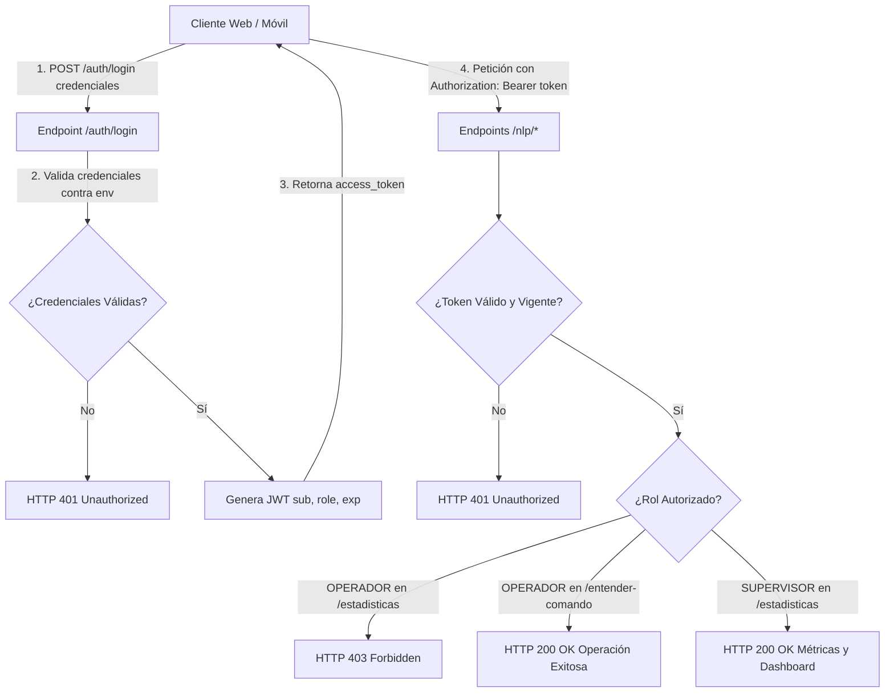

# Arquitectura Cloud, Seguridad JWT y Matriz de Evaluación (Mini-Azure LUIS v2)

## 1. Contexto y Objetivos de Migración

**Mini-Azure LUIS v2** evoluciona desde un entorno local cerrado (LAN) hacia una arquitectura moderna orientada a la **Nube Pública (Cloud PaaS)** con acceso seguro vía HTTPS y control de acceso basado en roles (**RBAC**).

Para lograr un despliegue viable, robusto y 100% gratuito en plataformas PaaS vigentes (2025-2026), se evaluaron las restricciones de hardware (512 MB RAM), la política de puertos únicos ($PORT) y el comportamiento del almacenamiento efímero tras periodos de inactividad (*cold starts*).

---

## 2. Matriz Comparativa de Plataformas Cloud Gratuitas (Investigación Fase 1)

A partir del análisis técnico y benchmark de plataformas Cloud vigentes, se evaluaron 4 opciones representativas:

| Plataforma Cloud | Capacidad Free Tier (RAM / CPU) | Inactividad (Sleep / Spin-down) | Latencia Cold Start | Soporte Docker / Puerto Único | Veredicto / Clasificación |
| :--- | :--- | :--- | :--- | :--- | :--- |
| **Render** *(Web Service Free)* | **512 MB RAM / 0.5 vCPU** | Duerme tras **15 min** de inactividad | 30 - 50 segundos | Excelente (Dockerfile en raíz, mapeo automático a `$PORT`, HTTPS gratuito) | **1º Lugar (Recomendada):** Mejor balance de simplicidad, CI/CD desde GitHub y despliegue monolítico. |
| **Koyeb** *(Free Eco Instance)* | **512 MB RAM / 0.1 vCPU** | Duerme tras **1 hora** de inactividad | 2 - 5 segundos | Muy bueno (Docker nativo, HTTPS global, puerto configurable) | **2º Lugar (Alternativa sólida):** Menor frecuencia de sleep y arranque en frío muy veloz. |
| **Streamlit Community Cloud + Render** | Frontend 1 GB RAM / Backend 512 MB | Streamlit duerme a las 12h / Backend duerme a los 15 min | Desincronizado (Streamlit despierto pero API dormida) | Arquitectura desacoplada (2 URLs públicas distintas, requiere configurar CORS) | **3º Lugar:** Mayor latencia inicial y complejidad al lidiar con dos servicios gratuitos independientes. |
| **Hugging Face Spaces** *(Docker)* | 16 GB RAM / 2 vCPU | N/A (modelo discontinuado) | N/A | Requiere suscripción PRO ($9/mes) para Spaces basados en Dockerfile personalizado | **Descartada:** Ya no es 100% gratuita para contenedores Docker a medida. |

### Decisión de Arquitectura: Monolito Contenedorizado en Render Free

Se selecciona **Render Free** bajo la estrategia de **Monolito Contenedorizado con un solo puerto expuesto ($PORT)** por las siguientes ventajas clave:
1. **URL Pública Única:** Todo el tráfico cliente y API viaja bajo el mismo dominio HTTPS (`https://mini-azure-luis-v2.onrender.com`), eliminando problemas de CORS (*Cross-Origin Resource Sharing*) y certificados SSL cruzados.
2. **Cero Desincronización de Cold Starts:** Al estar el backend FastAPI y el frontend empaquetados en la misma instancia, una sola petición de activación (*wake-up*) despierta todo el sistema simultáneamente.
3. **Consumo de Memoria Optimizado:** Scikit-Learn (TF-IDF + Logistic Regression) y FastAPI requieren menos de 180 MB en reposo, manteniéndose cómodamente por debajo del umbral de 512 MB de Render.

---

## 3. Modelo de Seguridad y Control de Acceso Basado en Roles (RBAC)

Para garantizar la integridad y confidencialidad de la operación agroexportadora expuesta a internet, se implementa autenticación basada en **JSON Web Tokens (JWT)** con firma simétrica **HS256**.

### Matriz de Permisos por Rol

| Recurso / Endpoint | Método | OPERADOR | SUPERVISOR | Sin Autenticación |
| :--- | :---: | :---: | :---: | :---: |
| `/health` | `GET` | `200 OK` | `200 OK` | `200 OK` (Público) |
| `/auth/login` | `POST` | `200 OK` | `200 OK` | `200 OK` (Público) |
| `/nlp/analizar-texto` | `POST` | `200 OK` | `200 OK` | `401 Unauthorized` |
| `/nlp/entender-comando` | `POST` | `200 OK` | `200 OK` | `401 Unauthorized` |
| `/nlp/estadisticas` | `GET` | **`403 Forbidden`** | `200 OK` | `401 Unauthorized` |
| `/nlp/estadisticas/reiniciar` | `POST` | **`403 Forbidden`** | `200 OK` | `401 Unauthorized` |

---

## 4. Riesgos Mitigados frente al Despliegue LAN (v1 vs v2)

1. **Exposición de Red sin Barreras:** En la versión LAN v1, cualquier dispositivo en la misma subred Wi-Fi/Ethernet podía invocar `/nlp/estadisticas/reiniciar` y borrar la bitácora. En la v2, toda llamada requiere un JWT criptográfico firmado y verificado en cada request.
2. **Escalada de Privilegios:** La dependencia `require_role(["SUPERVISOR"])` bloquea activamente a usuarios con token de `OPERADOR`, garantizando que operarios de campo solo puedan enviar reportes operativos.
3. **Fugas de Secretos:** La clave `JWT_SECRET_KEY` y las credenciales se inyectan estrictamente vía variables de entorno en el panel de Render, nunca almacenadas en el código ni rastreadas en Git.
4. **Resiliencia ante Almacenamiento Efímero:** El gestor analítico `analytics.py` garantiza autoconsistencia y regeneración limpia ante reinicios o pérdidas de disco en *cold starts*, evitando errores `500 Internal Server Error`.
